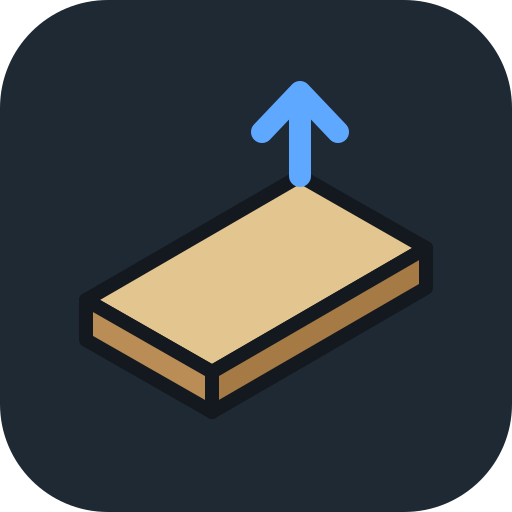
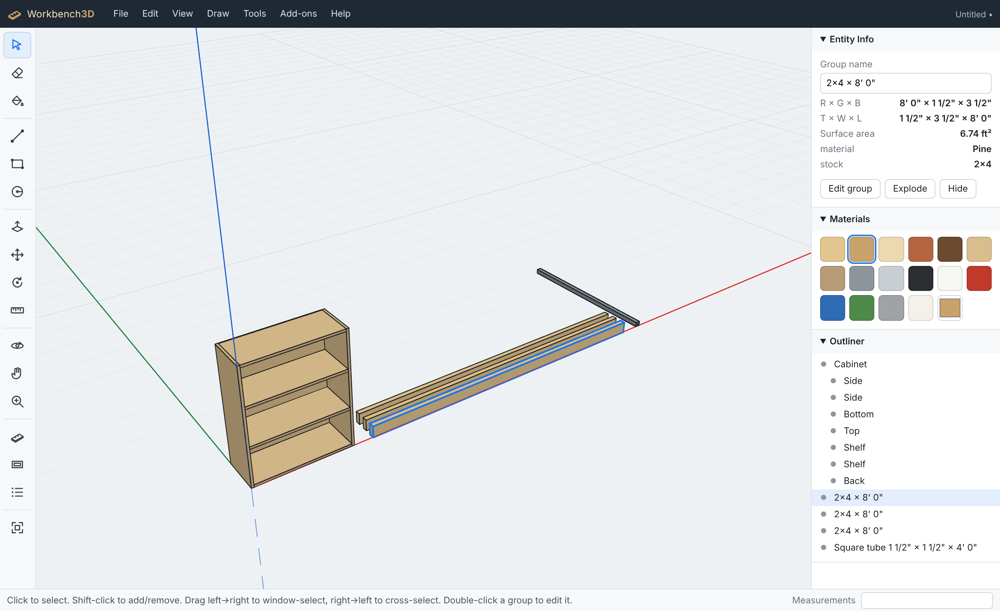

<p align="center"></p>

<h1 align="center">Workbench3D</h1>

<p align="center"><b>An open-source push/pull 3D modeler for woodworking, welding and fabrication, home design and RV interiors.</b><br>
Runs in your browser or as a desktop app on macOS, Windows and Linux. MIT licensed. Add-ons welcome.</p>



Draw a rectangle, push/pull it into a board, snap to edges and midpoints, group the parts, and get a cut list. If you've used a push/pull modeler before, the workflow will feel familiar: same kind of tools, same single-key shortcuts, type exact sizes at any time.

## Features

- **Push/pull modeling.** Draw on the ground or on any face, push/pull faces into solids. Rectangles drawn on a face become pockets or bosses; lines across a face split it, so rabbets, dados and notches work.
- **Smart snapping.** Endpoint, midpoint, on-edge, on-face, red/green/blue axes, parallel/perpendicular to an edge, and "from point" alignment. Arrow keys lock an axis (→ red, ← green, ↑ blue); hold **Shift** to lock whatever direction you're on.
- **Exact input.** Just start typing: `24, 48` for a rectangle, `3/4` for a push/pull, `2' 6-1/2"`, `19mm`, `x5` for five copies.
- **Groups and components.** Parts stay separate and don't stick to each other. Components are reusable parts: edit one and every copy updates (Make Unique breaks the link). Double-click to edit inside.
- **Tools:** Select, Eraser, Paint, Line, Arc, Rectangle, Circle, Polygon, Push/Pull, Offset, Move (with copy and arrays), Rotate (15° snaps), Scale (grips, typed factors or sizes, mirror), Tape Measure (guide lines and points), Dimension, Section Plane, Orbit, Pan, Zoom.
- **Organize:** Tags (layers) with visibility, Scenes (saved views with tag state, PageUp/PageDown), Outliner, right-click context menu.
- **Built-in add-ons:**
  - **Lumber:** real dressed sizes (a 2x4 is 1½" × 3½"), plywood and MDF sheets.
  - **Steel Profiles:** square, rectangular and round tube, angle, channel, flat bar, round bar, by gauge.
  - **Cut List:** every part with T × W × L, identical parts grouped, board feet, CSV export.
- **Views:** standard views, perspective or parallel projection, X-ray, zoom extents.
- **Files:** `.wb3d` (JSON, diff-friendly), export STL (for 3D printing, in mm), OBJ and PNG. Autosave keeps your work if the tab closes.
- **Trackpad friendly:** Option/Alt-drag orbits and Option-Shift-drag pans, so you don't need a 3-button mouse.

## Get it

**Desktop app:** download the installer for your system from the [Releases page](https://github.com/drakeg/workbench3d/releases).
On macOS the app is not yet signed with an Apple Developer ID. The first time you open it, right-click (or Control-click) the app → **Open** → **Open**.

**In the browser:** run it locally (below) or use the GitHub Pages build if it's enabled for the repo. In Chrome or Edge you can install it as an app from the address bar.

## Run from source

```bash
git clone https://github.com/drakeg/workbench3d
cd workbench3d
npm install
npm run dev          # http://localhost:5173
```

Desktop app (needs [Rust](https://rustup.rs) and the [Tauri prerequisites](https://v2.tauri.app/start/prerequisites/)):

```bash
npm run tauri dev    # run the desktop app
npm run tauri build  # make an installer (.dmg/.app on macOS, .msi/.exe on Windows, .deb/.AppImage on Linux)
```

## Quick start

| Do this | Keys |
| --- | --- |
| Draw a rectangle, type `24, 48`, Enter | **R** |
| Push/pull it up, type `3/4`, Enter | **P** |
| Select all, make a group | **⌘/Ctrl+A**, **⌘/Ctrl+G** |
| Move it; tap **Option/Ctrl** to copy, then type `x4` | **M** |
| Make a reusable component | **G** |
| Inset a face / stretch with grips | **F** / **S** |
| Orbit / pan / zoom | middle-drag (or Option/Alt-drag) / right-drag / scroll |
| Zoom to fit | **Shift+Z** |
| All shortcuts | **Help → Keyboard Shortcuts** |

## Add-ons

Add-ons are plain JavaScript modules that add tools and commands. They get a stable API (`api.createBox`, `api.createExtrusion`, `api.ui.form`, `api.registerTool`, …).
See **[docs/ADDONS.md](docs/ADDONS.md)** and the example [`examples/addons/cabinet-box.js`](examples/addons/cabinet-box.js). Load one with **Add-ons → Add-on Manager → Load add-on file…**

## Contributing

Bug reports, ideas and pull requests are all welcome. Start with **[CONTRIBUTING.md](CONTRIBUTING.md)**, look at the **[ROADMAP](ROADMAP.md)** for what's next, and read **[docs/ARCHITECTURE.md](docs/ARCHITECTURE.md)** for a tour of the code.

## About

Workbench3D is an independent project written from scratch. It's not affiliated with or endorsed by Trimble or SketchUp, and it doesn't use any of their code or assets.

[MIT License](LICENSE)
