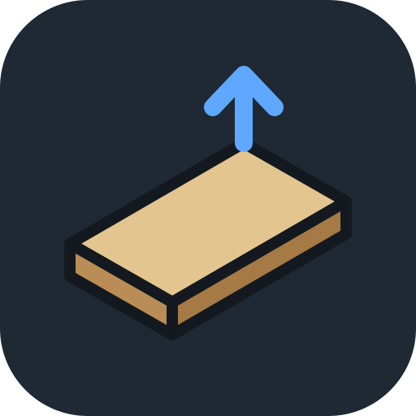
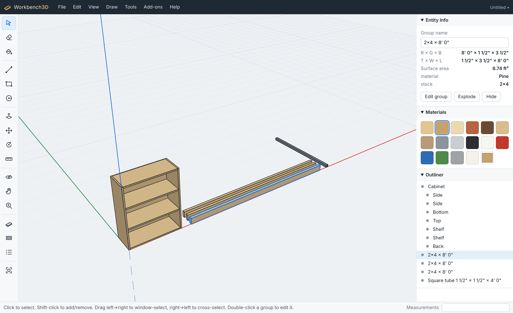

<p align="center"></p>

<h1 align="center">Workbench3D</h1>

<!-- badges:start -->
<p align="center">
  <a href="https://www.typescriptlang.org/"></a>
  <a href="https://developer.mozilla.org/en-US/docs/Web/JavaScript"></a>
  <a href="https://www.rust-lang.org/"></a>
  <a href="https://www.swift.org/"></a>
  <a href="https://threejs.org/"></a>
  <a href="https://vite.dev/"></a>
  <a href="https://tauri.app/"></a>
  <a href="compose.yml"></a>
</p>
<p align="center">
  <a href="https://github.com/drakeg/workbench3d/actions/workflows/ci.yml"></a>
  <a href="https://github.com/drakeg/workbench3d/actions/workflows/mac.yml"></a>
  <a href="https://github.com/drakeg/workbench3d/actions/workflows/pages.yml"></a>
  <a href="https://github.com/drakeg/workbench3d/actions/workflows/release.yml"></a>
</p>
<p align="center">
  <a href="https://github.com/drakeg/workbench3d/releases"></a>
  <a href="https://github.com/drakeg/workbench3d/blob/main/LICENSE"></a>
  <a href="https://github.com/drakeg/workbench3d/issues"></a>
  <a href="https://github.com/drakeg/workbench3d/pulls"></a>
  <a href="CONTRIBUTING.md"></a>
</p>
<!-- badges:end -->

<p align="center"><b>An open-source push/pull 3D modeler for woodworking, welding and fabrication, home design and RV interiors.</b><br>
Runs in your browser or as a desktop app on macOS, Windows and Linux. MIT licensed. Add-ons welcome.</p>



Draw a rectangle, push/pull it into a board, snap to edges and midpoints, group the parts, and get a cut list. If you've used a push/pull modeler before, the workflow will feel familiar: same kind of tools, same single-key shortcuts, type exact sizes at any time.

## Features

- **Push/pull modeling.** Draw on the ground or on any face, push/pull faces into solids. Rectangles drawn on a face become pockets or bosses; lines across a face split it, so rabbets, dados and notches work.
- **Smart snapping.** Endpoint, midpoint, on-edge, on-face, red/green/blue axes, parallel/perpendicular to an edge, and "from point" alignment. Arrow keys lock an axis (→ red, ← green, ↑ blue); hold **Shift** to lock whatever direction you're on.
- **Exact input.** Just start typing: `24, 48` for a rectangle, `3/4` for a push/pull, `2' 6-1/2"`, `19mm`, `x5` for five copies.
- **Groups and components.** Parts stay separate and don't stick to each other. Components are reusable parts: edit one and every copy updates (Make Unique breaks the link). Double-click to edit inside.
- **Tools:** Select, Eraser, Paint, Line, Arc, Rectangle, Circle, Polygon, Push/Pull, Offset, Move (with copy and arrays), Rotate (15° snaps), Scale (grips, typed factors or sizes, mirror), Tape Measure (guide lines and points), Dimension, Section Plane, Orbit, Pan, Zoom.
- **Organize:** Tags (layers) with visibility, Scenes (saved views with tag state, PageUp/PageDown), Outliner, right-click context menu.
- **Built-in add-ons:**
  - **Lumber:** real dressed sizes (a 2x4 is 1½" × 3½"), plywood and MDF sheets.
  - **Steel Profiles:** square, rectangular and round tube, angle, channel, flat bar, round bar, by gauge.
  - **Cut List:** every part with T × W × L, identical parts grouped, board feet, CSV export. The Layout tab fits the parts onto 4×8 sheets, boards or 20' steel sticks with your saw kerf, an edge trim and the grain direction, shows how many to buy, and prints a cutting plan (PDF) with a diagram of every sheet and board. Enter optional USD prices per complete sheet or board in the Layout tab to calculate a purchase estimate; unquoted or unfittable stock is marked incomplete, and quotes appear in PDF/CSV exports. Prices are stored locally per stock group.
- **Views:** standard views, perspective or parallel projection, X-ray, zoom extents.
- **Files:** `.wb3d` (JSON, diff-friendly), export STL (for 3D printing, in mm), OBJ, glTF/GLB and PNG. File → Export Shop Views (PDF)… creates top/front/right orthographic wireframe projections on a letter landscape page with overall dimensions and a consistent printed 1:N scale. Print at 100% (not fit-to-page); these are reference shop views, not certified manufacturing plans. Autosave keeps your work if the tab closes.
- **Imports STL meshes.** File → Import supports binary and ASCII `.stl`, with explicit millimetre/inch choice because STL files have no standard unit metadata. Imported meshes become separate, undoable groups. STL has no part hierarchy or material metadata.
- **Exports glTF 2.0 and GLB.** File → Export produces self-contained glTF JSON or binary GLB for other 3D tools, with nested group transforms, face colors and metre-based units (the glTF standard). Hidden groups are excluded.
- **Ready-to-edit sample cabinet.** Add-ons → Insert Sample Cabinet… creates a 24 × 24 × 30 in six-panel plywood cabinet as one undoable operation. Open Cut List to review dimensions, layout and printable plans. This is a demo, not a fabrication specification.
- **Opens SketchUp files.** File → Import… (or drag a `.skp` onto the window) brings in SketchUp 2013 and later models with their groups, components, colours, tags, scenes and guides, read on your computer by the MIT-licensed [openskp](https://www.npmjs.com/package/openskp) library. Textures come in as plain colours for now.
- **Trackpad friendly:** Option/Alt-drag orbits and Option-Shift-drag pans, so you don't need a 3-button mouse. Turn on *Two-finger scroll pans the view* in Settings to pan with two fingers and pinch to zoom.
- **Copy and paste** parts between models and windows, and **drag a `.wb3d` file** onto the window to open it.

## Get it

**Desktop app:** download the installer for your system from the [Releases page](https://github.com/drakeg/workbench3d/releases). It follows each platform's conventions:

- **Mac:** a native app for Apple silicon (M1 and later) on macOS 26 or later, written in Swift with a Metal 3D view (source in [`mac/`](mac)). Each model is its own document window with autosave and versions, Open Recent, and full undo. Trackpad gestures: scroll to pan, pinch to zoom, Option-scroll to orbit. It opens the same `.wb3d` files as the web app.
- **Windows:** Windows 11 type and spacing, sentence-case menus, Settings in the File menu and the toolbar gear (with an app theme choice), F1 help, F2 rename, Shift+F10 context menu, light/dark theme, and `.wb3d` files open from Explorer.
On macOS the app is not yet notarized by Apple. The first time you open it, macOS blocks it: go to **System Settings → Privacy & Security** and click **Open Anyway**.

**In the browser:** run it locally (below) or use the GitHub Pages build if it's enabled for the repo. In Chrome or Edge you can install it as an app from the address bar.

## Run from source

```bash
git clone https://github.com/drakeg/workbench3d
cd workbench3d
npm install
npm run dev          # http://localhost:5173
```

**LAN testing with Docker Compose (browser build only):**
```bash
cp .env.example .env
docker compose up -d --build
# Open http://localhost:8087 or http://<host-LAN-IP>:8087 from a trusted device
docker compose down
```
`WB3D_PORT` and `WB3D_BIND_ADDRESS` are configurable in `.env`. The app is unauthenticated; do not expose the port publicly. Projects are saved locally in the browser and as exported `.wb3d` files, not in a server database.

Desktop app (needs [Rust](https://rustup.rs) and the [Tauri prerequisites](https://v2.tauri.app/start/prerequisites/)):

```bash
npm run tauri dev    # run the desktop app
npm run tauri build  # make an installer (.msi/.exe on Windows, .deb/.AppImage on Linux)
cd mac && ./build.sh --open   # build and open the native Mac app (needs Xcode 26)
```

## Quick start

| Do this | Keys |
| --- | --- |
| Draw a rectangle, type `24, 48`, Enter | **R** |
| Push/pull it up, type `3/4`, Enter | **P** |
| Select all, make a group | **⌘/Ctrl+A**, **⌘/Ctrl+G** |
| Move it; tap **Option/Ctrl** to copy, then type `x4` | **M** |
| Make a reusable component | **G** |
| Inset a face / stretch with grips | **F** / **S** |
| Orbit / pan / zoom | middle-drag (or Option/Alt-drag) / right-drag / scroll |
| Zoom to fit | **Shift+Z** |
| All shortcuts | **Help → Keyboard Shortcuts** |

## Add-ons

Add-ons are plain JavaScript modules that add tools and commands. They get a stable API (`api.createBox`, `api.createExtrusion`, `api.ui.form`, `api.registerTool`, …).
See **[docs/ADDONS.md](docs/ADDONS.md)** and the example [`examples/addons/cabinet-box.js`](examples/addons/cabinet-box.js). Load one with **Add-ons → Add-on Manager → Load add-on file…**

## Project planning

Current work is tracked in the [planned sprints](docs/SPRINTS.md) and [prioritized backlog](docs/BACKLOG.md). See the [Agile workflow](docs/AGILE.md) and [agent instructions](AGENTS.md) for implementation and review conventions.

For versioning, release timing, platform checks, and recovery procedures, see [RELEASES.md](RELEASES.md). For vulnerability handling, see [SECURITY.md](SECURITY.md); for the first paying-customer hypothesis, see [docs/COMMERCIALIZATION.md](docs/COMMERCIALIZATION.md).

## Contributing

Bug reports, ideas and pull requests are all welcome. Start with **[CONTRIBUTING.md](CONTRIBUTING.md)**, look at the **[ROADMAP](ROADMAP.md)** for what's next, and read **[docs/ARCHITECTURE.md](docs/ARCHITECTURE.md)** for a tour of the code.

## About

Workbench3D is an independent project written from scratch. It's not affiliated with or endorsed by Trimble or SketchUp, and it doesn't use any of their code or assets.

[MIT License](LICENSE)
